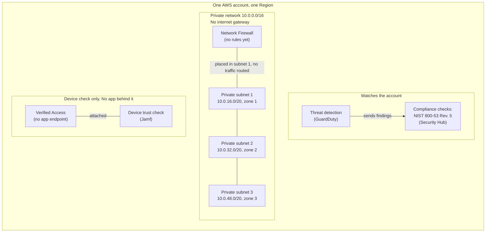

# AWS Zero Trust lab

[](https://github.com/CloudVeteran/AWS-Zero-Trust-Terraform/actions/workflows/terraform.yml)

Terraform for a small AWS lab: a VPC with three private subnets, an AWS Verified Access instance with a Jamf device trust provider, a Network Firewall, a GuardDuty detector, and Security Hub CSPM subscribed to NIST SP 800-53 Rev. 5.

Portfolio project by Marlon Garcia, AWS Certified Solutions Architect and CompTIA Security+.


*How to read this: the gray box is one AWS account, the green box is a private network with no internet gateway, the firewall sits in subnet 1 and does not inspect traffic, the Jamf check is not connected to an app, and GuardDuty sends findings to Security Hub.*

## Status and scope

This is a lab and portfolio project, not a production architecture. It is not an authority to operate, a FedRAMP package, or a complete Zero Trust design. The control table lists NIST SP 800-53 Rev. 5 controls these resources can support. A row in that table is not a control implementation statement, and it is not evidence that the control is satisfied.

## Quick start

Clone the repo and run these from the repository root. They need no AWS credentials and create no resources.

```bash
terraform fmt -check
terraform init -backend=false
terraform validate
```

`terraform plan` and `terraform apply` need AWS credentials and an S3 bucket you own. `backend.tf` has the bucket name, `encrypt = true`, and `use_lockfile = true`. Replace the bucket before a real `terraform init`. Network Firewall and Verified Access are billable. Default tags set `Environment` to `Lab`.

Copy `terraform.tfvars.example` to `terraform.tfvars` to override the Region, project name, or VPC CIDR. `terraform.tfvars` is gitignored.

## Architecture

GuardDuty and Security Hub are account-and-Region services. The VPC resources are in `modules/zero-trust`. When both services are enabled in the same account and Region, GuardDuty sends its findings to Security Hub on its own. There is no `aws_securityhub_product_subscription` in this repo.



The three subnets share one private network. The firewall endpoint is only in subnet 1, and nothing routes traffic to it. Verified Access is attached to the Jamf device check and has no app endpoint.

Redraw the picture at the top with Graphviz installed: `pip install diagrams`, then `python docs/diagram.py`.

## What the code creates

| Piece | Where | What is configured |
| --- | --- | --- |
| VPC | `modules/zero-trust` | CIDR `10.0.0.0/16` by default. DNS hostnames and DNS support are enabled. Terraform defines no internet gateway, NAT gateway, security group, network ACL, or route table. A new VPC still receives AWS's default security group, default network ACL, and main route table, whose only route is the local VPC route. |
| Private subnets | `modules/zero-trust` | Three subnets from `cidrsubnet(vpc_cidr, 4, n)` for `n` = 1, 2, 3. With the default CIDR those are `10.0.16.0/20`, `10.0.32.0/20`, and `10.0.48.0/20`. Availability zones are `data.aws_availability_zones.available.names[0..2]`. That data source sets neither `state` nor `opt-in-status`, so the names are the first three the API returns, and an enabled Local Zone can be one of them. |
| Verified Access | `modules/zero-trust` | One instance, one device trust provider (`device_trust_provider_type = jamf`, policy reference `device-trust`), and the attachment between them. No endpoint, group, or access policy. |
| Network Firewall | `modules/zero-trust` | One firewall. Its only subnet mapping is the first private subnet. The policy sets stateless default and fragment default to `aws:forward_to_sfe`. No stateless or stateful rule group, and no logging. No route table sends traffic to the endpoint. |
| GuardDuty | root `main.tf` | One detector, `enable = true`, `finding_publishing_frequency = SIX_HOURS`. `SIX_HOURS` is how often GuardDuty republishes an existing finding. It is the standalone-account default. Protection plans (S3, EKS, malware, RDS, Lambda, runtime monitoring) are not set, so they stay at the CreateDetector API default. |
| Security Hub CSPM | root `main.tf` | `aws_securityhub_account` with `enable_default_standards = false` and `auto_enable_controls = true`. One standards subscription, NIST SP 800-53 Rev. 5, ARN `arn:${partition}:securityhub:${region}::standards/nist-800-53/v/5.0.0`. CIS and AWS Foundational Security Best Practices are not subscribed. New controls that AWS adds to the enabled standard are turned on automatically. |

## NIST SP 800-53 Rev. 5

Support means the resource is a relevant piece of the control. It does not mean the control is met.

| Component | Controls | Support in this lab |
| --- | --- | --- |
| VPC and private subnets | SC-7 Boundary Protection | Private subnets with no internet gateway keep the lab off the public internet. Terraform defines no security groups or network ACLs. AWS's default network ACL allows all inbound and outbound traffic, and the default security group allows traffic from itself, so SC-7 is only partly addressed. |
| Network Firewall | SC-7 Boundary Protection, AC-4 Information Flow Enforcement | The firewall is the enforcement point those controls call for. This policy only forwards stateless traffic to the stateful engine. With no rule groups and no routes into the endpoint, traffic is not inspected and AC-4 is not enforced. |
| Verified Access and the Jamf device trust provider | IA-3 Device Identification and Authentication | The Jamf provider is attached, so the instance has a device-identity source. AC-17 Remote Access is the control Verified Access is built for, and this lab has no endpoint or access policy, so it does not provide remote access. |
| GuardDuty detector | SI-4 System Monitoring, SI-4(2) Automated Tools and Mechanisms for Real-Time Analysis, SI-4(4) Inbound and Outbound Communications Traffic | The detector is continuous, automated analysis. Foundational sources that ship with a detector include VPC Flow Logs and DNS logs, which is the SI-4(4) link. No notification channel or response runbook is defined. |
| Security Hub CSPM, NIST SP 800-53 Rev. 5 subscription | CA-2 Control Assessments, CA-7 Continuous Monitoring | The subscription enables AWS's automated checks for a subset of Rev. 5. Requirements that need a manual method are outside those checks. The subscription is not an assessment plan and not an authorization package. |

## Out of scope

- **IAM Identity Center.** Standing up Identity Center is an organization-level action. The AWS provider has no portable resource that creates the Identity Center instance in a standalone account. A Verified Access user trust provider of type `iam-identity-center` also fails apply unless Identity Center is already enabled, so this lab leaves it out.
- Interface VPC endpoints (PrivateLink).
- Verified Access endpoints, groups, and Cedar policies.
- Network Firewall rule groups, firewall logging, and routes that would send subnet traffic through the firewall.
- GuardDuty protection-plan configuration, and any Security Hub standard other than NIST SP 800-53 Rev. 5.
- Multi-account administration, a delegated administrator, or aggregation across Regions.

## Layout

```
.
├── main.tf                      # provider, network module, GuardDuty, Security Hub
├── variables.tf
├── outputs.tf
├── versions.tf                  # Terraform >= 1.10, AWS provider ~> 6.0
├── backend.tf                   # S3 state; replace the bucket before a real init
├── terraform.tfvars.example
├── modules/zero-trust/          # VPC, subnets, Verified Access, Network Firewall
├── docs/
│   ├── architecture.png         # picture at the top of this file
│   ├── diagram.py               # redraws that picture
│   └── icons/                   # Verified Access icon used by diagram.py
├── LICENSE                      # MIT, Copyright (c) 2026 Marlon Garcia
└── README.md
```

## Outputs

| Name | Meaning |
| --- | --- |
| `vpc_id` | VPC ID |
| `verified_access_instance_id` | Verified Access instance ID |
| `guardduty_detector_id` | GuardDuty detector ID in the provider Region |
| `securityhub_nist_subscription_arn` | Subscription ARN for NIST SP 800-53 Rev. 5 |
